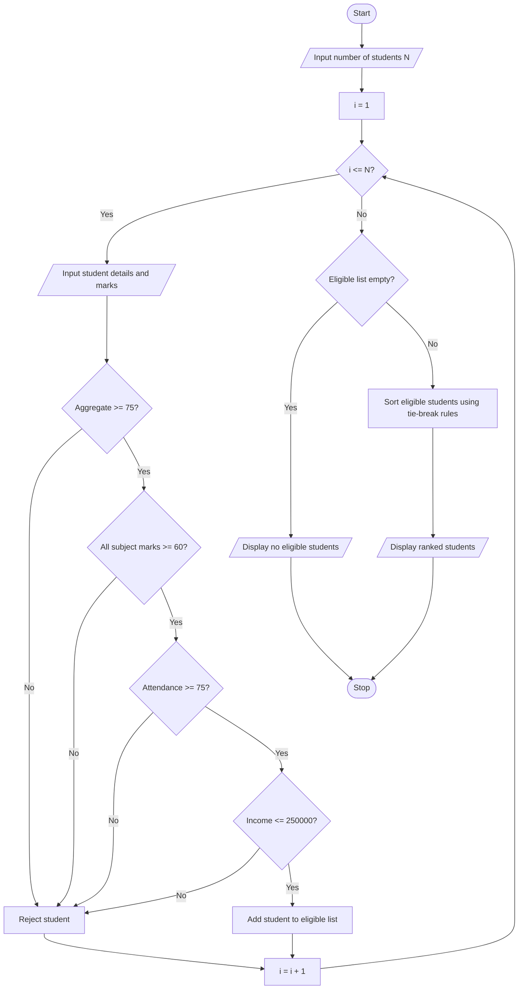

# University Scholarship Allocation System

## 1. Problem Statement

Design a Python program to allocate university scholarships by evaluating students based on aggregate marks, subject-wise minimum marks, attendance percentage, and annual family income. The program should identify eligible students, rank them according to aggregate marks, and resolve ties using predefined rules. Higher attendance is preferred when aggregate marks are equal, and lower family income is preferred when both aggregate marks and attendance are equal.

## 2. Algorithm

1. Start.
2. Input the number of students.
3. For each student, input name, aggregate marks, number of subjects, marks in each subject, attendance percentage, and annual family income.
4. Check the eligibility criteria:
   - Aggregate marks must be at least 75%.
   - Every subject mark must be at least 60%.
   - Attendance must be at least 75%.
   - Annual family income must not exceed ₹2,50,000.
5. If all conditions are satisfied, add the student to the eligible list.
6. Repeat Steps 3–5 for all students.
7. If the eligible list is empty, display “No students are eligible.”
8. Otherwise, sort eligible students by:
   - Aggregate marks in descending order.
   - Attendance in descending order.
   - Family income in ascending order.
   - Name in alphabetical order if all previous criteria are equal.
9. Display the eligible students with their ranks.
10. Stop.

The eligibility limits and ranking rules are sample rules for this assignment.

## 3. Flowchart


## 5. Sample Input

```
Enter number of students: 2

Student 1
Enter student name: Ravi
Enter aggregate marks (%): 82
Enter number of subjects: 2
Enter marks for subject 1: 75
Enter marks for subject 2: 80
Enter attendance (%): 90
Enter annual family income (Rs.): 200000

Student 2
Enter student name: Priya
Enter aggregate marks (%): 91
Enter number of subjects: 2
Enter marks for subject 1: 85
Enter marks for subject 2: 90
Enter attendance (%): 95
Enter annual family income (Rs.): 180000
```

## 6. Sample Output

```
Eligible Students - Scholarship Ranking
1 Priya | Aggregate: 91.0 | Attendance: 95.0 | Income: 180000.0
2 Ravi | Aggregate: 82.0 | Attendance: 90.0 | Income: 200000.0
```

