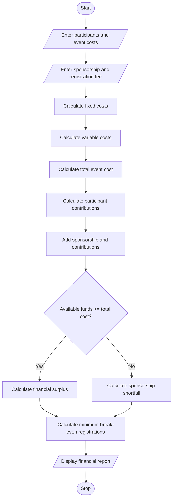

# Campus Event Financial Planning

## 1. Problem Statement

Develop a Python program to calculate the total expenses of a campus event, including venue, equipment, catering, transport, and certificate costs. Determine the total participant contributions, sponsorship shortfall, and minimum number of registrations required to break even.

## 2. Algorithm

1. Start.
2. Read the number of expected participants.
3. Read venue, equipment, and transport costs.
4. Read catering and certificate costs per participant.
5. Read the sponsorship amount.
6. Read the registration fee per participant.
7. Calculate fixed costs.
8. Calculate variable costs for all participants.
9. Calculate total event expenses.
10. Calculate total participant contributions.
11. Calculate the available amount from sponsorship and registrations.
12. Determine the sponsorship shortfall or surplus.
13. Calculate the minimum registrations required to break even.
14. Display all financial details.
15. Stop.

## 3. Flowchart

## 4. Sample Input

```
Enter expected number of participants: 100
Enter venue cost: 10000
Enter equipment cost: 5000
Enter transport cost: 3000
Enter catering cost per participant: 200
Enter certificate cost per participant: 50
Enter sponsorship amount: 15000
Enter registration fee per participant: 300
```

## 5. Sample Output

```
--- Campus Event Financial Report ---
Fixed Costs: 18000.0
Variable Costs: 25000.0
Total Event Cost: 43000.0
Participant Contributions: 30000.0
Sponsorship: 15000.0
Financial Surplus: 2000.0
Minimum Registrations for Break-even: 60
```
