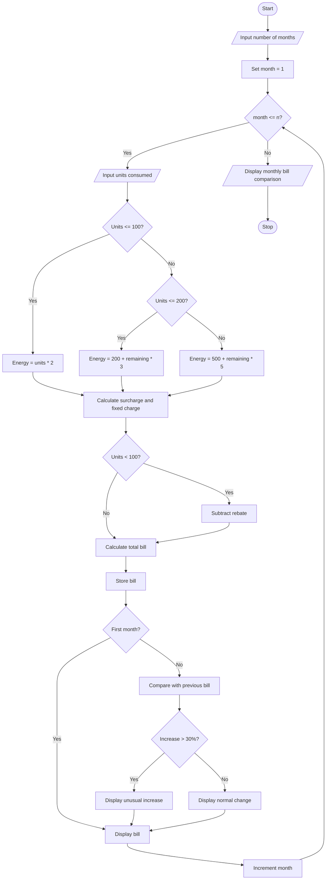

# Progressive Electricity Billing System

## 1. Problem Statement

Design a Python program to calculate household electricity bills using a progressive billing system. The program should calculate charges based on multiple electricity consumption slabs, fixed charges, additional surcharges, and applicable rebates. It should accept electricity consumption details for several months, calculate the total bill for each month, compare monthly bills, and identify unusual increases in electricity charges.

Billing rules used in this program (sample values):

| Electricity consumption  | Rate per unit |
| ------------------------ | ------------- |
| First 100 units          | ₹2            |
| Next 100 units (101–200) | ₹3            |
| Above 200 units          | ₹5            |

Additional rules:

- Fixed charge: ₹50 per month.
- Surcharge: 5% of energy charges.
- Rebate: ₹20 if energy consumption is below 100 units.
- An increase of more than 30% compared with the previous month's bill is considered unusual.

## 2. Algorithm

1. Start.
2. Input the number of months.
3. For each month, input electricity consumption in units.
4. Calculate energy charges using progressive slabs:
   - First 100 units at ₹2 per unit.
   - Next 100 units at ₹3 per unit.
   - Remaining units at ₹5 per unit.
5. Add the fixed charge of ₹50.
6. Calculate a 5% surcharge on energy charges.
7. If consumption is below 100 units, subtract a rebate of ₹20.
8. Calculate the final electricity bill.
9. Store the monthly bill.
10. Compare each month's bill with the previous month's bill.
11. If the bill increases by more than 30%, identify it as an unusual increase.
12. Display monthly bills and unusual increases.
13. Stop.

## 3. Flowchart


## 5. Sample Input

```
Enter number of months: 3

Month 1
Enter electricity units consumed: 80

Month 2
Enter electricity units consumed: 120

Month 3
Enter electricity units consumed: 250
```

## 6. Sample Output

```
Month 1
Energy Charge: 160.0
Fixed Charge: 50
Surcharge: 8.0
Rebate: 20
Total Bill: Rs. 198.0

Month 2
Energy Charge: 260.0
Fixed Charge: 50
Surcharge: 13.0
Rebate: 0
Total Bill: Rs. 323.0

Month 3
Energy Charge: 750.0
Fixed Charge: 50
Surcharge: 37.5
Rebate: 0
Total Bill: Rs. 837.5

Monthly Bill Comparison

Month 1 Bill: Rs. 198.0
Month 2 Bill: Rs. 323.0
Unusual Increase: 63.13 %
Month 3 Bill: Rs. 837.5
Unusual Increase: 159.29 %
```


