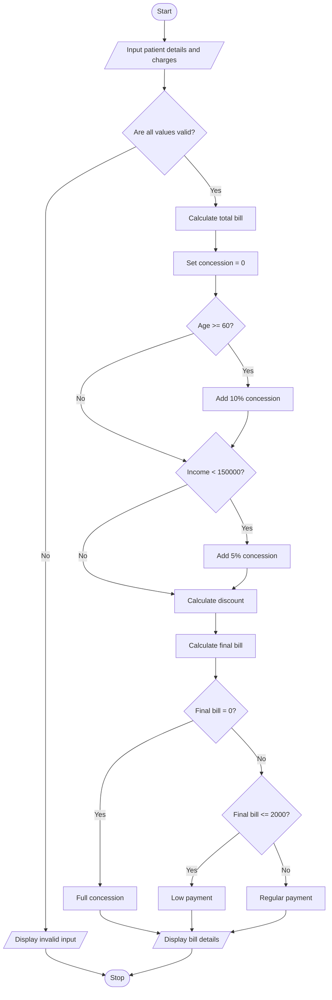

# Hospital Billing and Patient Classification System

## 1. Problem Statement

Design a Python program to calculate hospital bills by processing consultation charges, diagnostic charges, and treatment charges. The system should apply conditional concessions based on patient eligibility, validate billing constraints, and calculate the final payable amount. It should also classify patients according to a predefined payment policy, such as regular payment, partial payment, or full concession.

Sample billing rules used in this program:

- Consultation charge: ₹500
- Diagnostic charge: ₹1,000
- Treatment charge: ₹2,000
- Senior citizens (age 60 or above) receive a 10% concession.
- Patients with income below ₹1,50,000 receive an additional 5% concession.
- Total concession cannot exceed 15%.
- Final bill cannot be negative.

Sample payment classification:

| Final bill   | Patient classification |
| ------------ | ---------------------- |
| ₹0           | Full concession        |
| ₹1–₹2,000    | Low payment            |
| Above ₹2,000 | Regular payment        |

These are assumed rules for the assignment. Actual hospital policies may differ.

## 2. Algorithm

1. Start.
2. Input patient name, age, and annual income.
3. Input consultation, diagnostic, and treatment charges.
4. Validate that all charges and income are non-negative.
5. Calculate the total bill by adding all three charges.
6. Check whether the patient is a senior citizen.
7. If age is 60 or above, apply a 10% concession.
8. Check whether annual income is below ₹1,50,000.
9. If eligible, apply an additional 5% concession.
10. Ensure the total concession does not exceed 15%.
11. Calculate the final payable amount.
12. Classify the patient according to the payment policy.
13. Display the total bill, concession, final amount, and patient classification.
14. Stop.

## 3. Flowchart

## 4. Sample Input

```
HOSPITAL BILLING SYSTEM

Enter patient name: Ravi
Enter patient age: 65
Enter annual income: 120000
Enter consultation charge: 500
Enter diagnostic charge: 1000
Enter treatment charge: 2000
```

## 5. Sample Output

```
--- BILL DETAILS ---

Patient Name: Ravi
Total Bill: Rs. 3500.0
Concession: 15 %
Discount: Rs. 525.0
Final Bill: Rs. 2975.0
Patient Classification: Regular Payment
```


