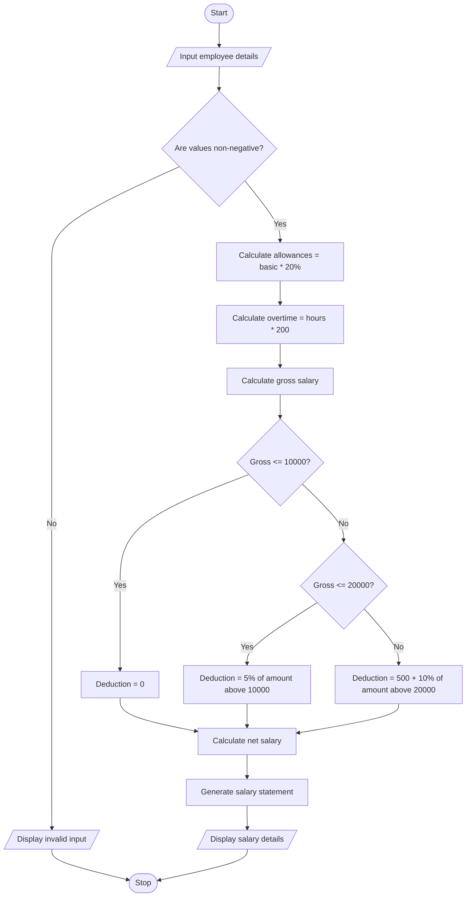

# Employee Payroll and Deduction Analysis System

## 1. Problem Statement

Design a Python program to calculate employee salaries based on basic pay, allowances, overtime, and incentives. The system should calculate the gross salary, apply progressive deductions based on salary slabs, determine the total deductions, and calculate the final net salary. Finally, generate a formatted salary statement displaying all salary components and deductions.

Sample payroll rules used in this program:

Salary components:

- Basic pay: Entered by the user.
- Allowances: 20% of basic pay.
- Overtime: Number of overtime hours × ₹200.
- Incentives: Entered by the user.

Progressive deduction rules:

| Gross salary  | Deduction rate |
| ------------- | -------------- |
| First ₹10,000 | 0%             |
| Next ₹10,000  | 5%             |
| Above ₹20,000 | 10%            |

These are assumed rates for this programming assignment.

## 2. Algorithm

1. Start.
2. Input employee name and basic pay.
3. Input overtime hours and incentives.
4. Calculate allowances as 20% of basic pay.
5. Calculate overtime pay at ₹200 per hour.
6. Calculate gross salary by adding basic pay, allowances, overtime pay, and incentives.
7. Calculate progressive deductions:
   - First ₹10,000 at 0%.
   - Next ₹10,000 at 5%.
   - Remaining amount above ₹20,000 at 10%.
8. Calculate net salary by subtracting total deductions from gross salary.
9. Generate a formatted salary statement.
10. Display salary components, deductions, gross salary, and net salary.
11. Stop.

## 3. Flowchart

## 4. Sample Input

```
EMPLOYEE PAYROLL SYSTEM

Enter employee name: Ravi
Enter basic pay: 20000
Enter overtime hours: 10
Enter incentives: 1000
```

## 5. Sample Output

```
--- SALARY STATEMENT ---

Employee Name: Ravi
Basic Pay: Rs. 20000.0
Allowances: Rs. 4000.0
Overtime Pay: Rs. 2000.0
Incentives: Rs. 1000.0
Gross Salary: Rs. 27000.0
Total Deduction: Rs. 1200.0
Net Salary: Rs. 25800.0
```

