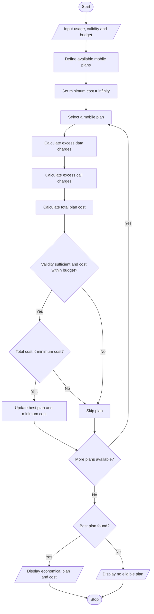

# Multi-Plan Telecommunications Cost Optimization System

## 1. Problem Statement

Design a Python program to evaluate multiple mobile recharge plans based on a user's data usage, call minutes, validity period, and budget. The system should calculate the total cost of each plan, including excess usage charges when the user exceeds the available data or call limits. It should check whether each plan satisfies the user's budget and validity requirements, compare all eligible plans, and identify the most economical plan.

Sample mobile plan rules used in this program:

| Plan   | Cost | Data  | Calls   | Validity |
| ------ | ---- | ----- | ------- | -------- |
| Plan A | ₹199 | 2 GB  | 100 min | 28 days  |
| Plan B | ₹299 | 5 GB  | 200 min | 28 days  |
| Plan C | ₹399 | 10 GB | 300 min | 56 days  |

Additional rules:

- Extra data charge: ₹20 per GB.
- Extra call charge: ₹1 per minute.
- The user enters their required data, call minutes, minimum validity, and budget.
- Only plans satisfying all requirements are considered eligible.
- The eligible plan with the lowest total cost is selected.

All plan prices and charges are assumed values for this assignment.

## 2. Algorithm

1. Start.
2. Input the user's required data, call minutes, minimum validity, and budget.
3. Define the available mobile plans with their prices, data limits, call limits, and validity.
4. Set the minimum cost to infinity.
5. For each mobile plan:
   - Calculate excess data usage.
   - Calculate excess call charges.
   - Calculate the total plan cost.
6. Check whether the plan satisfies the data, call, validity, and budget requirements.
7. If eligible, compare its total cost with the minimum cost.
8. Update the minimum cost and selected plan if a cheaper eligible plan is found.
9. Repeat for all available plans.
10. Display the most economical eligible plan and its total cost.
11. If no plan is eligible, display an appropriate message.
12. Stop.

## 3. Flowchart

## 4. Sample Input

```
MOBILE PLAN COST OPTIMIZATION

Enter required data (GB): 6
Enter required call minutes: 220
Enter required validity (days): 28
Enter your budget (Rs.): 500
```

## 5. Sample Output

```
--- PLAN DETAILS ---

Plan A
Excess Charges: Rs. 200.0
Total Cost: Rs. 399.0

Plan B
Excess Charges: Rs. 40.0
Total Cost: Rs. 339.0

Plan C
Excess Charges: Rs. 0.0
Total Cost: Rs. 399.0

--- BEST PLAN ---

Most Economical Plan: Plan B
Total Cost: Rs. 339.0
```

