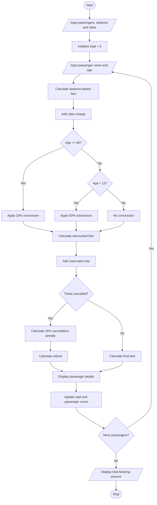

# Railway Fare and Reservation Calculator

## 1. Problem Statement

Design a Python program to calculate railway fares for multiple passengers based on travel distance, selected travel class, and passenger age. The system should calculate fares using distance slabs, apply age-based concessions, add reservation fees, and calculate cancellation penalties when a ticket is cancelled. It should display the individual passenger fares and the total reservation amount.

Sample railway fare rules used in this program:

Distance-based fare:

| Distance     | Fare per km |
| ------------ | ----------- |
| First 100 km | ₹2          |
| Next 200 km  | ₹1.50       |
| Above 300 km | ₹1          |

Travel class charges:

| Class     | Additional charge |
| --------- | ----------------- |
| Sleeper   | ₹100              |
| AC 3 Tier | ₹300              |
| AC 2 Tier | ₹500              |

Other rules:

- Senior citizens (age 60 or above) receive a 20% concession.
- Children below 12 years receive a 50% concession.
- Reservation fee: ₹50 per passenger.
- Cancellation penalty: 25% of the fare before reservation fee.

All rates and concession rules are assumed values for this assignment.

## 2. Algorithm

1. Start.
2. Input the number of passengers.
3. Input the travel distance and selected travel class.
4. For each passenger:
   - Input passenger name and age.
   - Calculate the basic fare using distance slabs.
   - Add the additional class charge.
   - Apply the age-based concession if eligible.
   - Add the reservation fee.
5. Ask whether the ticket is cancelled.
6. If cancelled, calculate a cancellation penalty of 25% of the fare before reservation fee.
7. Calculate the final payable amount or refund amount.
8. Display each passenger's fare details.
9. Calculate and display the total amount for all passengers.
10. Stop.

## 3. Flowchart

## 4. Sample Input

```
RAILWAY FARE AND RESERVATION CALCULATOR

Enter number of passengers: 2
Enter travel distance (km): 250

1. Sleeper
2. AC 3 Tier
3. AC 2 Tier

Select travel class: 1
Cancel ticket? (yes/no): no

Passenger 1
Enter passenger name: Ravi
Enter age: 65

Passenger 2
Enter passenger name: Priya
Enter age: 10
```

## 5. Sample Output

```
Passenger: Ravi
Travel Class: Sleeper
Basic Fare: 525.0
Concession: 20.0 %
Reservation Fee: 50
Final Fare: 470.0

Passenger: Priya
Travel Class: Sleeper
Basic Fare: 525.0
Concession: 50.0 %
Reservation Fee: 50
Final Fare: 312.5

Total Booking Amount: Rs. 782.5
```
