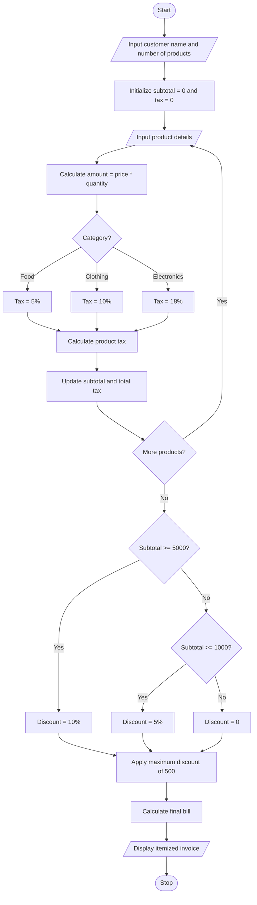

# Retail Billing with Multiple Discount Rules

## 1. Problem Statement

Design a Python program to generate a retail bill for multiple products purchased by a customer. The system should calculate the price of each product based on its quantity, apply category-specific taxes, provide discounts based on purchase amount thresholds, and ensure that the total concession does not exceed a predefined maximum limit. Finally, it should generate an itemized invoice showing product details, subtotal, taxes, discounts, and the final payable amount.

Sample billing rules used in this program:

Category-specific taxes:

| Product category | Tax rate |
| ---------------- | -------- |
| Food             | 5%       |
| Clothing         | 10%      |
| Electronics      | 18%      |

Discount rules:

| Purchase subtotal | Discount    |
| ----------------- | ----------- |
| Below ₹1,000      | No discount |
| ₹1,000–₹4,999     | 5%          |
| ₹5,000 and above  | 10%         |

Additional rules:

- Maximum discount allowed: ₹500.
- Tax is calculated on the subtotal before discount.
- The final bill is calculated after subtracting the discount and adding taxes.

All tax rates and discount limits are assumed values for this assignment.

## 2. Algorithm

1. Start.
2. Input customer name and number of products.
3. Set subtotal and total tax to zero.
4. For each product:
   - Input product name, category, price, and quantity.
   - Calculate the product amount.
   - Identify the category-specific tax rate.
   - Calculate the product tax.
   - Add the amount and tax to their respective totals.
5. Calculate the total subtotal.
6. Check the subtotal and determine the discount percentage.
7. Calculate the discount amount.
8. Apply the maximum discount limit of ₹500.
9. Calculate the final bill by adding taxes and subtracting the discount.
10. Display the itemized invoice.
11. Display the final payable amount.
12. Stop.

## 3. Flowchart

## 4. Sample Input

```
RETAIL BILLING SYSTEM

Enter customer name: Ravi
Enter number of products: 3

Product 1
Enter product name: Rice
Enter category: food
Enter product price: 100
Enter quantity: 5

Product 2
Enter product name: Shirt
Enter category: clothing
Enter product price: 800
Enter quantity: 2

Product 3
Enter product name: Mouse
Enter category: electronics
Enter product price: 1000
Enter quantity: 1
```

## 5. Sample Output

```
------ ITEMIZED INVOICE ------

Customer Name: Ravi

Product: Rice
Quantity: 5
Amount: Rs. 500.0
Tax: Rs. 25.0

Product: Shirt
Quantity: 2
Amount: Rs. 1600.0
Tax: Rs. 160.0

Product: Mouse
Quantity: 1
Amount: Rs. 1000.0
Tax: Rs. 180.0

Subtotal: Rs. 3100.0
Total Tax: Rs. 365.0
Discount: Rs. 155.0
Final Payable Amount: Rs. 3310.0
```

