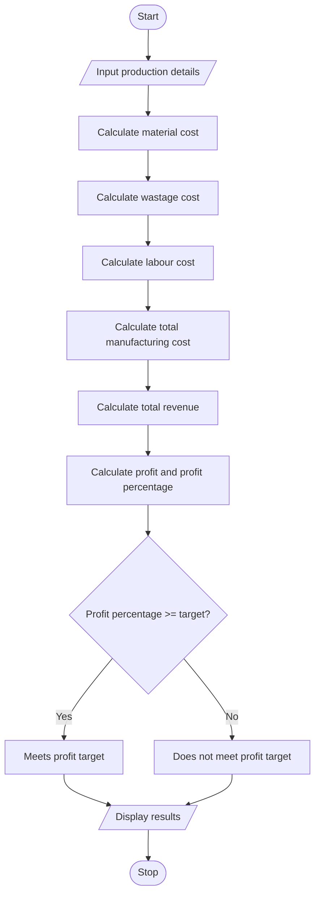

#  Manufacturing Cost and Profitability Analysis

## 1. Problem Statement

Develop a Python program to calculate the total manufacturing cost and profit of a product by considering material costs, labour charges, material wastage, and machine costs. Calculate the selling price and determine whether the production meets the specified profit target.

## 2. Algorithm

1. Start.
2. Read the number of units produced.
3. Read the material cost per unit.
4. Read the labour cost per unit.
5. Read the wastage percentage.
6. Read the total machine cost.
7. Read the selling price per unit.
8. Read the required profit target percentage.
9. Calculate total material cost.
10. Calculate wastage cost.
11. Calculate total labour cost.
12. Calculate total manufacturing cost.
13. Calculate total revenue.
14. Calculate profit and profit percentage.
15. Compare the profit percentage with the target.
16. Display the manufacturing cost, revenue, profit, and result.
17. Stop.

## 3. Flowchart

## 4. Sample Input

```
Enter number of units produced: 100
Enter material cost per unit: 50
Enter labour cost per unit: 20
Enter wastage percentage: 10
Enter total machine cost: 1000
Enter selling price per unit: 100
Enter required profit percentage: 20
```

## 5. Sample Output

```
--- Manufacturing Report ---
Material Cost: 5000.0
Wastage Cost: 500.0
Labour Cost: 2000.0
Machine Cost: 1000.0
Total Manufacturing Cost: 8500.0
Total Revenue: 10000.0
Profit: 1500.0
Profit Percentage: 17.65 %
Production does not meet the profit target.
```
