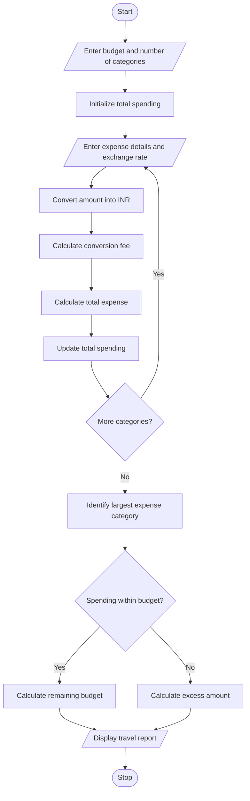

# Multi-Currency Travel Budget Analysis

## 1. Problem Statement

Develop a Python program to calculate travel expenses in different currencies by converting them into a common currency using supplied exchange rates. Include currency conversion fees, compare the total planned spending with the available budget, and identify the largest expense category.

## 2. Algorithm

1. Start.
2. Read the travel budget in the base currency.
3. Read the number of expense categories.
4. For each category:
   - Read the category name.
   - Read the expense amount.
   - Read the exchange rate.
   - Read the conversion fee percentage.
   - Convert the expense into the base currency.
   - Calculate the conversion fee.
   - Calculate the total expense including the fee.
5. Add all expenses to calculate total spending.
6. Identify the largest expense category.
7. Compare total spending with the budget.
8. Display the total spending, remaining budget or excess amount, and largest expense category.
9. Stop.

## 3. Flowchart

## 4. Sample Input

```
Enter travel budget in INR: 50000
Enter number of expense categories: 3

Category 1
Enter expense category: Accommodation
Enter expense amount: 100
Enter exchange rate (INR): 90
Enter conversion fee percentage: 2

Category 2
Enter expense category: Food
Enter expense amount: 150
Enter exchange rate (INR): 90
Enter conversion fee percentage: 2

Category 3
Enter expense category: Shopping
Enter expense amount: 200
Enter exchange rate (INR): 90
Enter conversion fee percentage: 2
```

## 5. Sample Output

```
Expense in INR: 9180.0
Expense in INR: 13770.0
Expense in INR: 18360.0

--- Travel Budget Report ---
Total Spending: 41310.0
Largest Expense Category: Shopping
Largest Expense: 18360.0
Remaining Budget: 8690.0
Travel is within the budget.
```
